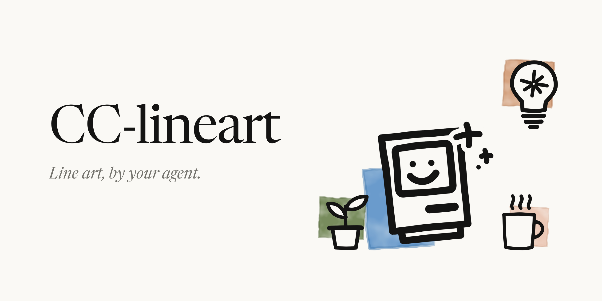
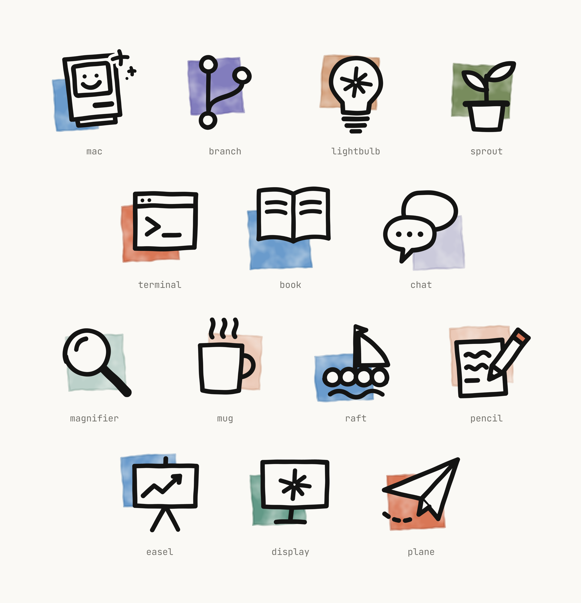
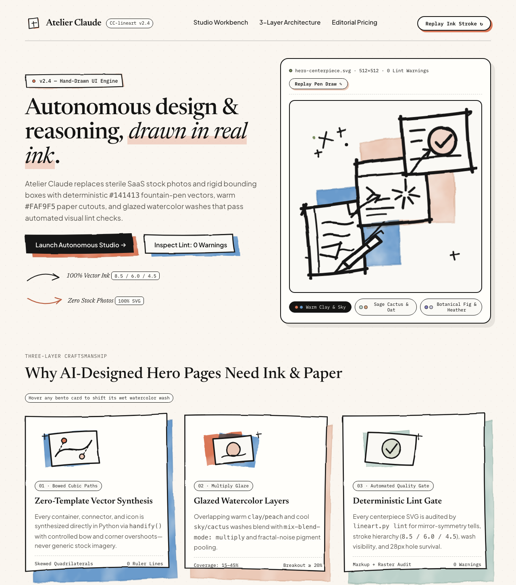
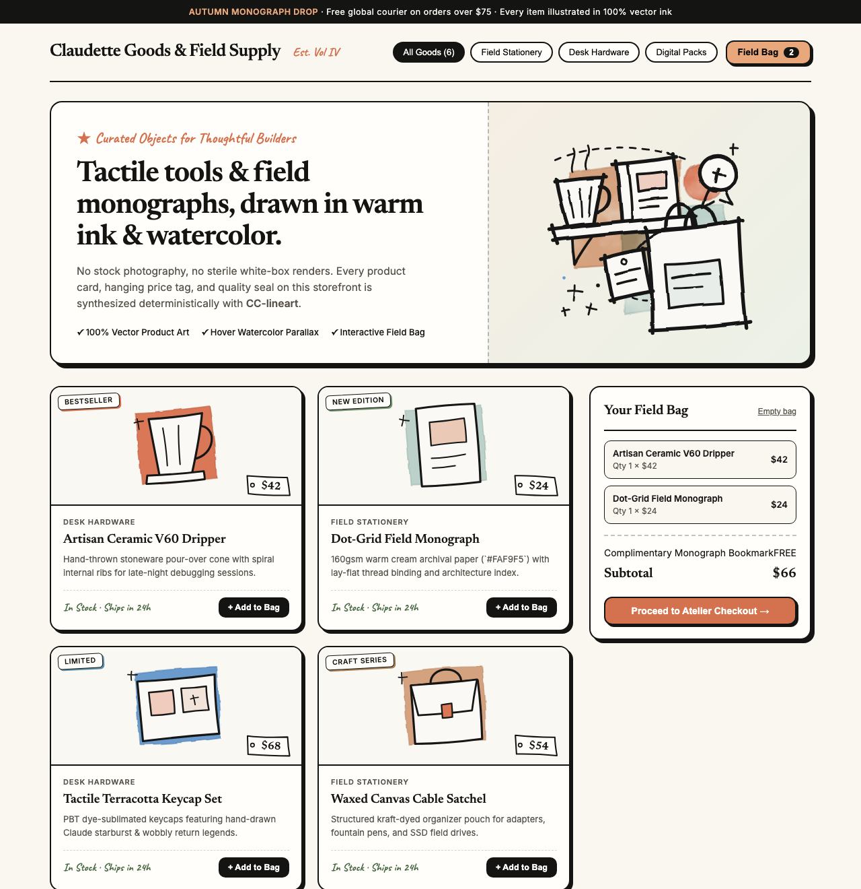
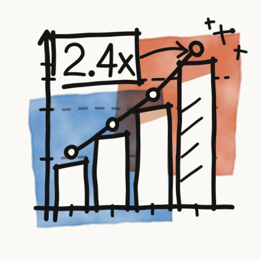
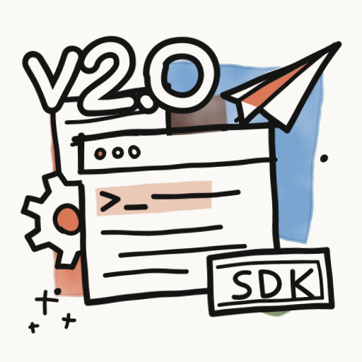
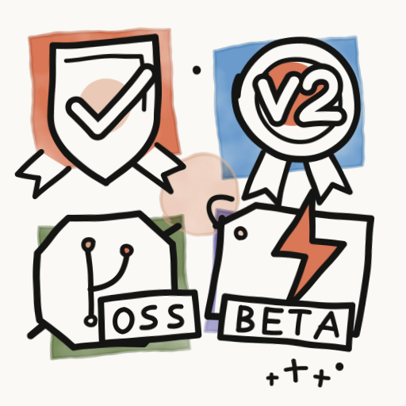

# CC-lineart

**Hand-drawn `#141413` ink + `#FAF9F5` paper cutout + mottled watercolor SVG design system for coding agents**, inspired by the editorial warmth of claude.com.

Originally created to draw 64×64 project icons, **CC-lineart** is a complete programmatic illustration and tactile web design system. Because its primitives (`handify`, `wobbly_circle`, `sparkle`), watercolor displacement filters (`#wash`, `#ink`), and mechanical style linter (`scripts/lineart.py lint`) are deterministic and resolution-independent, agents can use it to build **icons, full-page Hero landing pages, boutique e-commerce storefronts, interactive web UI kits, empty states, system architecture diagrams, editorial benchmark charts, open-source repo branding, and animated presentation visuals**.

<p align="center"></p>

---

## Why CC-lineart? (The Three-Layer Physical Metaphor)

Most AI-generated SVGs and web pages look like sterile templates: ruler-straight `<rect>` boxes, symmetric primitives, generic stock photo placeholders, and uniform 1px borders sitting on a flat plane.

Every `CC-lineart` piece is built from three physical layers, bottom to top:

1. **Layer 1 — Offset Watercolor Block (`<g id="layer-block">`)**: One or two irregular quadrilaterals in warm/cool brand pigments (`clay`, `sky`, `cactus`, `heather`, `plum`, `mineral`, `peach`, `kraft`, `olive`), offset 10–25% from the subject's center. A fractal-noise filter mottles its alpha (`wash`) and a darker rim (`stroke-opacity="0.55"`) mimics pigment pooling at the wet edge. On larger pieces (`>= 256px`), overlapping a warm wash and a cool wash with `mix-blend-mode: multiply` inside `isolation: isolate` glazes an authentic third mid-tone.
2. **Layer 2 — Paper Cutout Shapes (`#FAF9F5` / `{PAPER}`)**: Closed subject silhouettes filled with warm paper-white sit on top of the wash, occluding background construction lines while allowing **≥ 30% of the watercolor block to show** and **≥ 20% of the line art to break outside the wash boundary**.
3. **Layer 3 — Hand-Drawn Ink (`<g id="layer-ink">`, `#141413` / `{INK}`)**: Intentional pen strokes with round caps and joins, shallow Bezier bows (`handify`), architect-style corner overshoots (`--overshoot`), multi-weight hierarchy, and clustered unequal-arm sparkles (`sparkle`).

---

## 8 Core Application Scenarios & Visual Gallery

Through multi-agent exploration and `lineart.py lint` calibration (**0 warnings** across all 12 showcase SVGs), `CC-lineart` is proven across eight high-value workflows:

| # | Scenario | Best Used For | Key Engineering Pattern | Reference Directory |
| :- | :--- | :--- | :--- | :--- |
| **1** | **Project & Sidebar Icons (`64×64`)** | IDE / T3 Code project icons, CLI toolbars, category badges (`lg` 48px+ & `sm` 14–28px presets) | Single-wash offset block + high-contrast `{PAPER}` silhouette + 28px hole-survival check | [`motifs/`](motifs/) · [`scripts/lineart.py`](scripts/lineart.py) |
| **2** | **AI-Designed Editorial Hero Landing Pages** | SaaS & developer tool launches, product homepages, Bento feature grids, editorial pricing tiers | Split Hero with self-drawing 512×512 centerpiece + live watercolor theme switcher + Bento mini-illustrations + wax-seal pricing stamp | [`examples/pages-hero/`](examples/pages-hero/) · [`EVALUATION.md`](examples/pages-hero/EVALUATION.md) |
| **3** | **Boutique E-Commerce & Creator Storefronts** | Physical/digital goods shops, creator merch, skill/template marketplaces without stock photos | Custom inline `CC-lineart` product illustrations per SKU + tilted hanging price tags + stamp badges + interactive cart drawer | [`examples/pages-storefront/`](examples/pages-storefront/) · [`EVALUATION.md`](examples/pages-storefront/EVALUATION.md) |
| **4** | **Tactile UI Kits, Empty States & Interactive Web UI** | Zero-inbox / empty states, onboarding cards, `⌘K` search bars, toggles, toasts, live HTML/CSS workbenches | Shared zero-size SVG `<defs>` filter bank (`#ui-wash`, `#ui-ink`) + `vector-effect="non-scaling-stroke"` + hover wash parallax | [`examples/ui-kit/`](examples/ui-kit/) · [`EVALUATION.md`](examples/ui-kit/EVALUATION.md) |
| **5** | **Editorial Architecture & Multi-Agent Diagrams** | Engineering blog diagrams, RFC topologies, multi-agent fan-out/synthesis flows, RAG pipelines | Warm + cool glazed washes as logical zones (no dashed bounding boxes) + miniature motifs replacing `<text>` + S-curve `handify` buses | [`examples/diagrams/`](examples/diagrams/) · [`EVALUATION.md`](examples/diagrams/EVALUATION.md) |
| **6** | **Editorial DataViz, Benchmarks & KPI Cards** | Model launch comparisons, capability velocity charts, telemetry gauges, sparkline summary cards | Tiered `handify` wobble (`1.6–2.0` ticks/glyphs, `2.8–3.0` bars, `3.5` splines, `5.5` washes) to preserve quantitative accuracy | [`examples/dataviz/`](examples/dataviz/) · [`EVALUATION.md`](examples/dataviz/EVALUATION.md) |
| **7** | **Open-Source Repo Branding, Hero Cards & Badges** | GitHub README banners, OpenGraph social cards, release headers (`v2.0`), wax seals & verification stamps | Centerline double-stroke paper cutout lettering (all `INK` spines at `W + 2t` first, then all `PAPER` cores at `W` second) | [`examples/branding/`](examples/branding/) · [`EVALUATION.md`](examples/branding/EVALUATION.md) |
| **8** | **Animated Stroke-Draw Line Art & Slide Decks** | Keynote / HTML deck hero visuals, step-by-step workflow narratives, live self-drawing workspace scenes | `pathLength="1"` + sequential `data-step` CSS `stroke-dashoffset` choreography + delayed `{PAPER}` fill fade-in | [`examples/motion-and-slides/`](examples/motion-and-slides/) · [`EVALUATION.md`](examples/motion-and-slides/EVALUATION.md) |

---

### 1. Project & Sidebar Icons (`motifs/*.json`)

Built-in 64×64 motif library with dual rendering presets (`--size lg` for galleries/headers and `--size sm` with enlarged wash blocks and heavier `4.3` ink for 14pt–28px sidebar slots):

<p align="center"></p>

---

### 2. AI-Designed Editorial Hero Landing Pages & Boutique E-Commerce Storefronts ([`examples/pages-hero/`](examples/pages-hero/) · [`examples/pages-storefront/`](examples/pages-storefront/))

Standard AI-generated landing pages and e-commerce shops often fall flat because agents lack bespoke hero artwork or real product photography. `CC-lineart` lets an AI agent generate **100% self-contained, custom-illustrated full pages**:
- **Editorial Product Hero Page ([`hero-landing-page.html`](examples/pages-hero/hero-landing-page.html))**: Split Hero with a self-drawing 512×512 centerpiece (`hero-centerpiece.svg`), interactive watercolor palette switcher, handwritten margin annotations, a 3-card Bento feature grid with hover wash parallax, and a 2-tier pricing section with a terracotta wax-seal stamp.
- **Boutique E-Commerce & Marketplace Storefront ([`marketplace-storefront.html`](examples/pages-storefront/marketplace-storefront.html))**: Seasonal promo banner (`storefront-showcase.svg`), category filter pills, 6 custom-illustrated SKU cards with tilted hanging price tags (`$42`, `$24`, `$68`) and stamp badges (`BESTSELLER`, `LIMITED`), plus an interactive shopping bag drawer with an illustrated empty state.

| Editorial Hero Landing Page (`hero-landing-page.html`) | Boutique E-Commerce Storefront (`marketplace-storefront.html`) |
| :---: | :---: |
|  |  |
| **Hero Centerpiece (`hero-centerpiece.svg`)** | **Storefront Shelf & Tote (`storefront-showcase.svg`)** |
|  |  |

---

### 3. Tactile UI Component Kit, Empty States & Interactive Web UI ([`examples/ui-kit/`](examples/ui-kit/))

`CC-lineart` translates directly from static icons into full UI surfaces: product empty-state illustrations (`empty-state-inbox.svg`), UI component sticker sheets (`ui-component-sheet.svg` featuring a `⌘K` search bar, tactile toggle switch, status pill, notification card with CTA button, and radial gauge), and a self-contained interactive HTML/CSS + SVG workbench ([`interactive-demo.html`](examples/ui-kit/interactive-demo.html)) where the watercolor wash shifts off-axis on `:hover` and compresses on `:active`.

| Zero-Inbox Empty State (`empty-state-inbox.svg`) | 5-Primitive UI Sticker Sheet (`ui-component-sheet.svg`) |
| :---: | :---: |
|  |  |

---

### 4. Editorial Architecture & Multi-Agent Workflow Diagrams ([`examples/diagrams/`](examples/diagrams/))

Replaces sterile Mermaid/Graphviz boxes with warm editorial system diagrams. Overlapping watercolor washes group architectural stages without noisy bounding boxes; dashed rails and curved S-connectors pass *behind* `#FAF9F5` node cards while in-flight message capsules, magnifier lenses, and paper planes float *in front*.

| Multi-Agent Orchestration (`agent-orchestration.svg`) | RAG Ingestion & Vector Pipeline (`rag-pipeline.svg`) |
| :---: | :---: |
|  |  |

---

### 5. Editorial Data Visualization & Benchmark Infographics ([`examples/dataviz/`](examples/dataviz/))

Replaces clinical plotting output with editorial data journalism. Uses thermal contrast (`sky` baseline wash vs. `clay` frontier wash glazed via `multiply`) to highlight generational inflection points, paired with a tiered `handify` hierarchy that keeps bar heights and gauge angles quantitatively faithful while passing `lint` with zero geometric tells.

| Generational Benchmark Chart (`benchmark-comparison.svg`) | Telemetry KPI & Sparkline Card (`telemetry-kpi-card.svg`) |
| :---: | :---: |
|  |  |

---

### 6. Open-Source Repo Branding, Release Hero Cards & Badges ([`examples/branding/`](examples/branding/))

Gives developer tools and repositories an unmistakable hand-crafted identity without relying on external web fonts. Display typography (`v2.0`, `v2`, `✓`) uses the **centerline double-stroke paper cutout technique** (`W + 2t` ink spines drawn before `W` paper cores) so intersecting strokes merge into seamless paper cutouts.

| Release Launch Hero (`release-hero-card.svg`) | Artisanal Repo Stamps & Badges (`editorial-badges.svg`) |
| :---: | :---: |
|  |  |

---

### 7. Animated Stroke-Draw Line Art & Presentation Visuals ([`examples/motion-and-slides/`](examples/motion-and-slides/))

Because `CC-lineart` requires every `<path>` to be drawn as a single intentional movement of a pen (`references/art-direction.md`, Step 5), adding `pathLength="1"` and sequential `data-step` attributes turns any illustration into a choreographed self-drawing animation ([`motion-showcase.html`](examples/motion-and-slides/motion-showcase.html)) where background trails draw first, `{PAPER}` fills fade in to occlude under-lines, and watercolor washes gently breathe — while remaining 100% compatible with static `rsvg-convert` PNG/PDF exports.

| 3-Act Presentation Story (`slide-editorial-story.svg`) | Animated Creative Desk (`animated-creative-desk.svg`) |
| :---: | :---: |
|  |  |

---

## Install

Copy this repository into your coding agent's skills directory (e.g. `~/.claude/skills/cc-lineart` or `~/.codex/skills/cc-lineart`) and install the raster/lint dependencies:

```bash
# Debian / Ubuntu
sudo apt-get install librsvg2-bin imagemagick && pip install Pillow

# macOS
brew install librsvg imagemagick && pip install Pillow
```

---

## CLI Commands & Workflow

```bash
# 1. Inspect existing 64x64 motifs and brand palette
python3 -I scripts/lineart.py list
python3 -I scripts/lineart.py palette
python3 -I scripts/lineart.py suggest "terminal agent workflow"

# 2. Render a motif at lg (gallery/header) or sm (14-28px sidebar icon)
python3 -I scripts/lineart.py render mac -o out/mac.svg --size lg
python3 -I scripts/lineart.py render mac -o out/mac-sm.svg --size sm --color sky

# 3. Path-building helpers for custom drawings
python3 -I scripts/lineart.py handify "M10 10 L54 10 L54 40" --amount 0.8 --overshoot 2
python3 -I scripts/lineart.py circle 32 32 12
python3 -I scripts/lineart.py sparkle 50 14 5

# 4. Run mechanical + raster style lint and side-by-side 256px / 28px preview
python3 -I scripts/lineart.py lint out/mac.svg
python3 -I scripts/lineart.py preview out/mac.svg motifs/terminal.svg -o out/sheet.png
```

### Reproduce All 7 Expanded Scenario Suites

```bash
python3 -I examples/pages-hero/generate_hero_page.py
python3 -I examples/pages-storefront/generate_storefront.py
python3 -I examples/ui-kit/generate_ui_kit.py
python3 -I examples/diagrams/generate_diagrams.py
python3 -I examples/dataviz/generate_dataviz.py
python3 -I examples/branding/generate_branding.py
python3 -I examples/motion-and-slides/generate_motion_slides.py
```

---

## Brand Palette (`scripts/lineart.py`)

| Token | Fill Hex | Pooling Rim Hex | Temperature / Typical Role |
| :--- | :--- | :--- | :--- |
| `clay` | `#D97757` | `#B85C3E` | Warm signature terracotta; primary focal spot or frontier highlight |
| `sky` | `#6A9BCC` | `#4C7FB3` | Cool cerulean blue; pairs cleanly with `clay` or `peach` via `multiply` |
| `cactus` | `#BCD1CA` | `#93B0A6` | Soft sage mint; ideal for verified checks, active toggles, and calm zones |
| `heather` | `#CBCADB` | `#A4A2BF` | Soft lavender-grey; quiet secondary wash |
| `plum` | `#827DBD` | `#635DA3` | Deep cool violet; pairs with `sky` or `peach` (avoid `multiply` with `clay`) |
| `mineral` | `#629987` | `#4A7D6C` | Deep teal-green; strong architectural/telemetry anchor wash |
| `peach` | `#EBC9B7` | `#D3A58D` | Warm sand-blush; glazes effortlessly over `sky`, `mineral`, or `olive` |
| `kraft` | `#D4A27F` | `#B9845F` | Warm cardboard ochre; tactile UI and badge backing |
| `olive` | `#788C5D` | `#5D7046` | Earthy botanical green; organic storytelling and OSS badges |
| `{PAPER}` | `#FAF9F5` | — | Warm off-white paper fill that sits over the wash and hides background lines |
| `{INK}` | `#141413` | — | Warm charcoal-black ink stroke (`round` caps and joins) |

---

## Documentation & Art Direction References

- [`SKILL.md`](SKILL.md) — Agent entry point, workflow instructions, and multi-scenario overview
- [`references/art-direction.md`](references/art-direction.md) — The 7-step drawing process, line quality rules, composition checks, and 10-point critique checklist
- [`references/drawing-guide.md`](references/drawing-guide.md) — 64 vs. 512 grid scaling table, paint order, double-stroke lettering, and common mistakes
- **Scenario Evaluations & Engineering Guides**:
  - [`examples/pages-hero/EVALUATION.md`](examples/pages-hero/EVALUATION.md) — Editorial Product Hero landing pages, self-drawing hero centerpiece & wax-seal pricing
  - [`examples/pages-storefront/EVALUATION.md`](examples/pages-storefront/EVALUATION.md) — Boutique E-Commerce & Creator Marketplace storefronts with custom vector product cards
  - [`examples/ui-kit/EVALUATION.md`](examples/ui-kit/EVALUATION.md) — Tactile UI components, empty states, and interactive DOM + SVG filter choreography
  - [`examples/diagrams/EVALUATION.md`](examples/diagrams/EVALUATION.md) — Editorial architecture & multi-agent workflow diagrams
  - [`examples/dataviz/EVALUATION.md`](examples/dataviz/EVALUATION.md) — Editorial data visualization & tiered `handify` accuracy
  - [`examples/branding/EVALUATION.md`](examples/branding/EVALUATION.md) — Repo branding, OpenGraph/hero banners & double-stroke cutout typography
  - [`examples/motion-and-slides/EVALUATION.md`](examples/motion-and-slides/EVALUATION.md) — Sequenced `pathLength="1"` stroke-draw animation & presentation decks

## License

MIT
